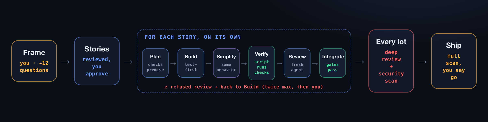

# E2E-SaaS Maker

**Describe your SaaS once. Agents build it end to end.**

A [Claude Code](https://claude.com/claude-code) plugin: you answer a few questions, approve
the scope, and agents plan, code, simplify and review your product story by story. No
agent ever reviews its own code.


## How it works



You are asked twice: **approve the scope** at the start, **go live** at the end.

## Install

```text
/plugin marketplace add zach0028/e2e-saas-maker
/plugin install e2e-saas-maker@e2e-saas-maker
```

The companion plugins come with it: `superpowers` (TDD), `code-simplifier`,
`pr-review-toolkit`, `security-guidance`.

## Use

In an empty folder:

```text
/e2e-saas-maker:frame "a booking page for yoga teachers"
/e2e-saas-maker:build
/e2e-saas-maker:ship
```

`/e2e-saas-maker:status` shows where the build is, at any time.

## What you get

| | |
|---|---|
| **Tested code** | every task starts with a failing test |
| **Clean code** | simplified after each story, clean-code rules built in |
| **Real reviews** | a fresh agent breaks the code on purpose to prove the tests catch it |
| **Design system** | generated from shadcn/ui and your brand; hard-coded colors are rejected |
| **Production-ready** | auth, billing, legal pages, security, SEO: decided with you, then checked |
| **Your call on prod** | nothing touches `main` or production without your go |

**[How it works, in detail →](docs/how-it-works.md)**

MIT
