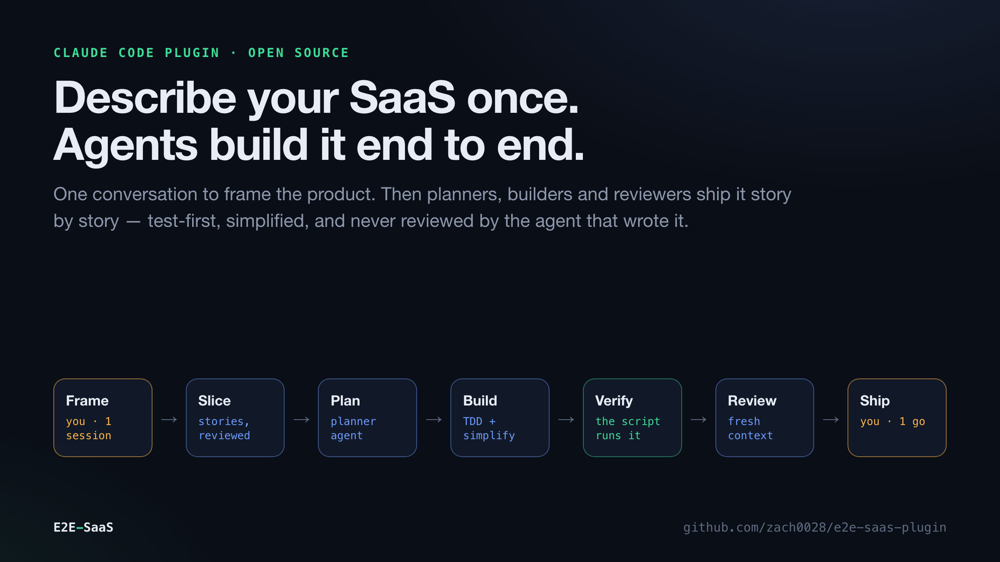
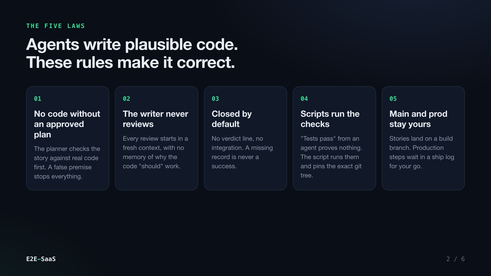
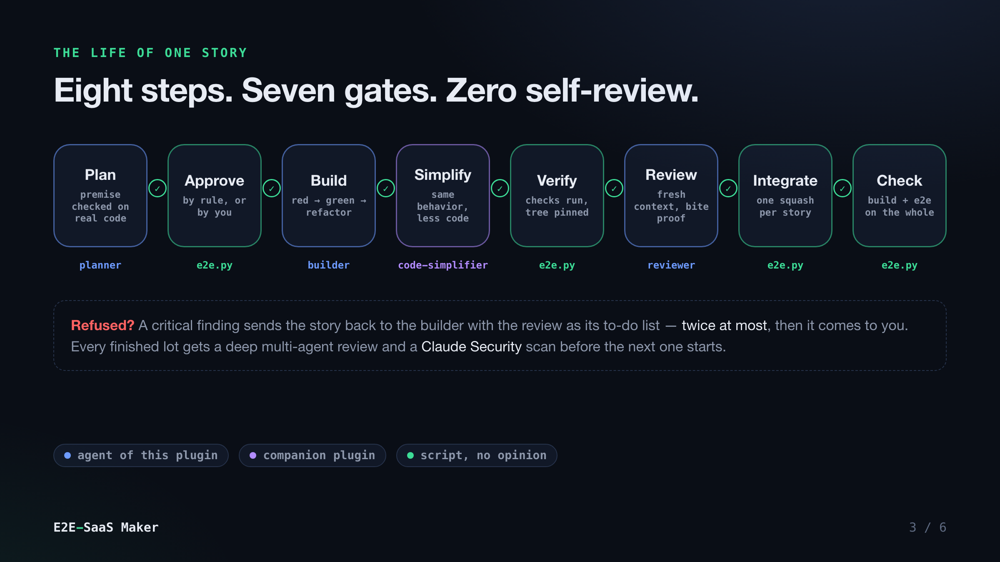
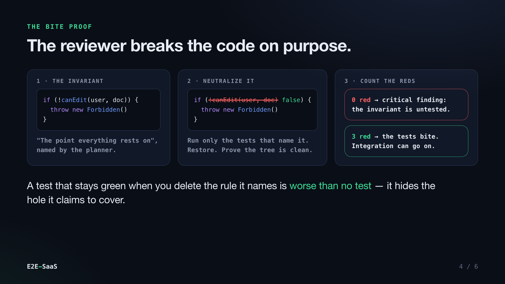
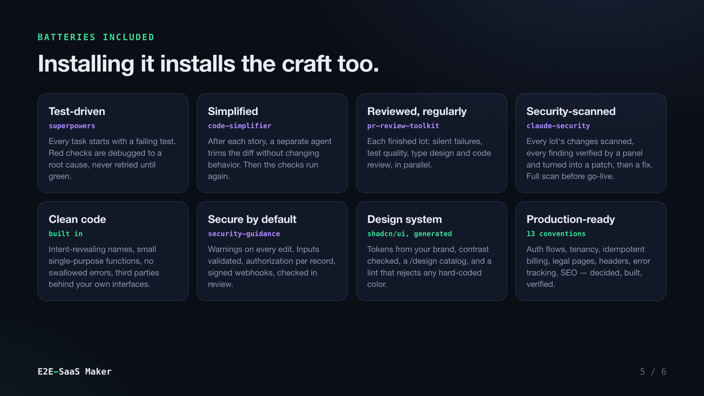

# How E2E-SaaS Maker works

**Describe your SaaS once. Agents build it end to end.**

A [Claude Code](https://claude.com/claude-code) plugin that takes you from an idea to a
tested, reviewed, ready-to-ship SaaS. You answer about a dozen questions and approve the
scope. Then agents plan, build, simplify and review the product story by story, without
waiting on you, until it is ready to go live.



## Why

Coding agents write *plausible* code. On a big build, plausible is how you end up with a
test suite that is all green and never checks the one rule that matters, an import of a
function that does not exist, or a feature that nobody asked for.

E2E-SaaS doesn't ask you to trust the agents. It is built around one idea: **no agent's
claim counts until something that did not write the code has checked it.** That checker is
a script, or a reviewer working in a fresh context.



## How it works

### 1. Frame: one session with you

`/e2e-saas-maker:frame` interviews you one question at a time:

- the idea and the job your product does;
- an optional reference product;
- the features, each scored 1–5 for complexity;
- **the graveyard**: everything you will *not* build;
- the angle, and how you will measure success;
- accounts, stack, design direction, and how much autonomy the agents get.

From your answers it writes a PRD and a stack decision record. It then slices the work into
**lots** and **stories**:

- each story delivers one slice of value end to end;
- every acceptance criterion can become a test;
- `s01` is always a *walking skeleton*: the stack scaffolded, with typecheck, lint, test,
  build and end-to-end checks wired in.

A separate agent reviews the story map against the PRD before you see it. You approve once.

### 2. Build: autonomous rounds

`/e2e-saas-maker:build` runs round after round until the product is done. Each story lives in its
own git worktree and goes through eight steps, with a gate between each one:



| Step | Who | What makes it trustworthy |
|---|---|---|
| Plan | `planner` agent | Checks the story's *premise* against the real code before planning. A false premise stops the story. |
| Approve | `e2e.py` | Follows the rule you chose: `full` autonomy approves any verified plan except data deletion; `guarded` sends risky plans to you. |
| Build | `builder` agent | Works test-first (red, green, refactor) and follows clean-code, security and performance baselines. It never commits. |
| Simplify | `code-simplifier` | A different agent trims the diff without changing behavior. |
| Verify | `e2e.py` | **Runs the checks itself**, commits exactly what it tested, and records the git tree hash. |
| Review | `reviewer` agent | Starts in a fresh context, opens every reference, compares the diff to the plan, and **breaks the code on purpose** to prove the tests bite. |
| Integrate | `e2e.py` | Refuses unless the plan was approved, the record matches the code, and the review allows it. Squashes the story into the build branch. |
| Check | `e2e.py` | Runs every check, including build and end-to-end, on the integrated whole. Nothing else integrates while it is red. |

When a lot is finished, the plugin runs a **deep review** before the next lot starts. Four
review agents work in parallel: silent failures, test quality, type design and general code
review. Alongside them, **[Claude Security](https://claude.com/marketplace/plugins/claude-security)**
scans everything that changed since the last scanned lot; each candidate finding is challenged
by its own verifier panel and comes with a patch file. Every real finding becomes a new story
(the patch is the builder's starting point, still test-first). A lot review only counts as done
when it records the scan's outcome: clean, findings filed, or unavailable with a reason.

### 3. Ship: with you

`/e2e-saas-maker:ship` runs a final review of the whole diff, a **full Claude Security scan of
the codebase** (nothing goes live with a verified critical or high finding open), and walks the
real product in a browser. It then goes through the **ship log** with you: accounts, secrets, migrations, DNS
and webhooks, collected story by story. Nothing touches production without your go. After
deploying, it checks the live site from the outside, because a green deploy does not prove
the site answers.

## The bite proof



The planner names *the point everything rests on*: the guard, predicate or query clause the
story depends on. The reviewer:

1. neutralizes that point;
2. runs the tests that cover it;
3. counts how many turn red;
4. restores the code and proves the tree is clean.

Zero reds means the invariant is untested, however big the suite is. That is a critical
finding.

## A design system, generated from shadcn/ui

Story `s02` turns your design direction (adjectives, reference products, brand color,
corner style, fonts, light/dark) into a real design system on top of
[shadcn/ui](https://ui.shadcn.com):

- **semantic tokens** for light and dark, derived in OKLCH from your brand color, every
  text/background pair checked against WCAG AA;
- **primitives you own** in `components/ui/`, added with the shadcn CLI the first time a
  story needs one — never hand-rolled, customized through variants;
- a **`/design` catalog** of every component, variant and state, in both themes;
- a **`design` lint check** (no dependencies) that fails any story using a raw color, a
  Tailwind palette class or an arbitrary value outside the tokens.

The library grows story by story, and the inventory in `docs/e2e/design-system.md` stays current.

## Production-ready by convention

`references/saas-conventions.md` lists what separates a demo from a product people pay
for, in 13 sections: authentication flows, organizations and tenancy, billing with
idempotent webhooks and server-side entitlements, data and migrations, legal pages and
data export, email deliverability, landing, pricing, onboarding and app shell, security
headers and env validation, error tracking and health checks, performance budgets,
accessibility and SEO, analytics, CI and previews.

At framing you decide each section with the agent (in, later, or n/a). Every "in" item
becomes acceptance criteria. Reviewers check them story by story, and the ship review
reports each one as done, partial or missing.

## Batteries included



Installing E2E-SaaS also installs its companion plugins from the official Anthropic
marketplace (declared as `dependencies` in `plugin.json`, so you get them automatically).
**superpowers** brings test-driven development and **code-simplifier** brings the
simplification pass. Together with the plugin's own **reviewer** and **clean-code**
rules, they are the core of how code gets written:

| Companion | Role in the build |
|---|---|
| [`superpowers`](https://github.com/obra/superpowers) | Test-driven development, systematic debugging, and verification before claiming done |
| `code-simplifier` | The simplification pass after every story |
| `pr-review-toolkit` | The lot reviews: silent failures, test quality, type design, code review |
| `security-guidance` | Security warnings on every edit |
| [`claude-security`](https://claude.com/marketplace/plugins/claude-security) | A scan of every finished lot and of the whole codebase before going live, findings verified by a panel and delivered as patches |

Clean-code principles, a security baseline and a performance baseline are built into the
builder and reviewer instructions (`skills/e2e-saas/references/craft.md`). The fresh-context
**reviewer** checks every story, and the lot and ship reviews add the companion reviewers on top.

## Install

```text
/plugin marketplace add zach0028/e2e-saas-maker
/plugin install e2e-saas-maker@e2e-saas-maker
```

Then, in an empty folder:

```text
/e2e-saas-maker:frame "a booking page for yoga teachers"
/e2e-saas-maker:build
/e2e-saas-maker:status     # any time
/e2e-saas-maker:ship
```

For long unattended runs: `/loop /e2e-saas-maker:build`. To stop the agents at any time, create
`docs/e2e/STOP`.

**Requirements:** Claude Code, git ≥ 2.38, Python ≥ 3.9 (standard library only). Run
`e2e.py doctor` to check your setup and the companion plugins.

**For a truly unattended build**, allow the worktree folder once (`init` prints the
`/add-dir` line), and run in a permission mode that auto-accepts edits and your package
manager and test commands. Test-mode keys (Stripe, email…) go in `.env.local` at the
project root, typed by you, never pasted in the chat; each worktree gets a copy.

## What you get in your repo

```text
docs/e2e/
├── prd.md              what and why, with the graveyard
├── stack.md            every lasting technical choice, and what was rejected
├── config.json         the checks every story must pass
├── stories.md          the story map (lots, complexity, dependencies, signals)
├── story-review.md     the fresh-context review of the map
├── stories/<id>/       research, plan, build notes, verification, review, ship notes
├── lots/               one deep review per finished lot
├── check.md            the last full check of the build branch
├── journal.md          what happened, round by round
└── ship.md             everything production needs, gathered from the stories at ship time
```

State is **derived from these files and git**, never stored elsewhere. You can stop and
resume at any time, compact the context, or open the project the next day: `e2e.py status`
picks up exactly where the files are.

## Honest limits

- **It builds a first version, not a company.** Expect a solid, tested v1 of the scope you
  approved. Judgment calls about the product stay yours.
- **It spends tokens.** Every story uses four agents (plan, build, simplify, review), and
  every lot runs four more reviewers plus a security scan. That is the price of not trusting a single context.
- **Legal pages are templates.** Terms and privacy are drafted for the product and flagged
  for your review; they are not legal advice.
- **Production needs you.** Accounts, secrets, DNS and the go-live are yours by design.

## Repository layout

```text
.claude-plugin/        plugin.json (dependencies), marketplace.json
skills/e2e-saas/       the skill: SKILL.md, references/, templates/, scripts/e2e.py (+ tests)
agents/                planner, builder, reviewer, story-reviewer
commands/              /e2e-saas-maker:frame, build, status, ship
docs/assets/           the illustrations (HTML sources in docs/assets/src/)
```

Run the script's tests: `cd skills/e2e-saas/scripts && python3 -m unittest test_e2e`.

Developing the plugin with `claude --plugin-dir .`: dependencies are not installed in that
mode, and a missing one keeps the plugin from loading. Install the four companions first.

## License

MIT
